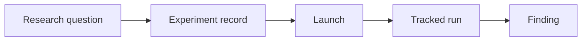

# Hiraku

**Hiraku** is a toolkit for AI-assisted data science. It provides customizable workflows and a shared metadata record around the model development lifecycle of data science projects.

<details>
<summary>Why "Hiraku"?</summary>

It's a hint towards a possible integration with [renkulab.io](https://renkulab.io). In renku (連句), the traditional Japanese art of collaborative linked poetry, hiraku (平句) are the regular verses where the sequence develops, shifts, and explores new directions — a metaphor for iterative, exploratory research within the Renku ecosystem. *[Discuss here.](https://github.com/SwissDataScienceCenter/hiraku/discussions/105)*

</details>

## Table of contents

* [How to Install](#how-to-install)
* [Quickstart](#quickstart)
* [Examples](#examples)
* [Dashboard](#dashboard)
* [Documentation](#documentation)
* [Contributing](#contributing)

## How to Install

First clone the repository:

```bash
git clone https://github.com/SwissDataScienceCenter/hiraku.git
cd hiraku
```

Install Hiraku from the checkout as a command-line tool:

```bash
uv tool install --force .
```

> [!TIP]
> Omit `--force` on a first install. Use it when reinstalling from this
> checkout after changing code without changing the package version.

<details>
<summary>Install optional tracking extras</summary>

Examples that use MLflow or W&amp;B need the matching optional extra in the
tool environment:

```bash
uv tool install --force '.[mlflow,wandb]'
```

See the [MLflow](docs/guides/tracking-mlflow.md) and
[W&amp;B](docs/guides/tracking-wandb.md) guides. If Hiraku is installed in a
project's environment, install the tracking SDK in that project instead.

</details>

## Quickstart

Create and initialize a project (Git is optional):

```bash
hiraku init my-project
cd my-project
```

Hiraku connects research questions to experiment records, launches, tracked
runs, and findings:



Browse the [Digits with MLflow](docs/examples/digits-mlflow/README.md) and
[Workflow examples](docs/examples/workflows/README.md) without creating a local
project. Use `hiraku example create` when you want to copy one into a directory.

## Examples

- [Digits with MLflow](docs/examples/digits-mlflow/README.md) — track model runs and metrics with MLflow.
- [Workflow examples](docs/examples/workflows/README.md) — try small Python and Markdown workflows.

Initialize an example with `hiraku example create NAME`. To include prepared
results or generate them, use one of these options:

<details>
<summary>Optional example data and result generation</summary>

| Command | Result |
| --- | --- |
| `hiraku example create NAME` | Copy the runnable project files only |
| `hiraku example create NAME --with-results` | Also copy bundled records and measured runs |
| `hiraku example create NAME --with-generator` | Also copy `generate_results.py` for running later |
| `hiraku example create NAME --generate` | Generate fresh records and runs immediately |

Use `hiraku example list` to see the available starting points.

`hiraku init [PATH]` initializes the current or explicit directory, optionally
using a local `--template`. `hiraku example create NAME [PATH]` creates a project from a
bundled example, without Git history or network access. Its default destination
is `./NAME`. Use
`hiraku example create NAME .` to initialize the current directory, or
`hiraku example create NAME my-project` to choose another destination.
Initialization does not require Git. Add `--git` to initialize the code repository
as a convenience. Repeating plain `hiraku init` leaves an initialized project
unchanged; repeating it with `--git` can add the code repository later.

The results and generator modes are available for the Digits example.
`--generate` cannot be combined with `--with-results`; generation can take
time and may install the example's dependencies.
Immediate generation runs in a temporary source project and imports the
completed results. Normal commands run in the current working tree, including
local changes.

</details>

## Dashboard

[Leaderboards](docs/tracking.md) select run sources and comparison metrics.
Use `--leaderboard NAME` with `hiraku leaderboard runs` or `hiraku dashboard` to choose one.

`hiraku dashboard` serves a local [marimo](https://marimo.io) notebook through a [marimo-studio](https://marimo-team.github.io/marimo-studio/) view with the record tree, the runs attributed to each record, run details with links to the tracking backend, and a performance plot. It needs the `dashboard` extra.

| Command | What it does |
| --- | --- |
| `hiraku dashboard` | Serve the read-only dashboard |
| `hiraku dashboard --include-code` | Also let the page show its notebook code (marimo menu, **⋯**) |
| `hiraku dashboard --init` | Copy the notebook to `hiraku/dashboard/app.py` so you can customize it |
| `hiraku dashboard --edit` | Open that copy in marimo-studio |
| `hiraku dashboard --init --edit` | Both in one step |

After `--init`, `hiraku dashboard` serves your copy. In the editor, the
`runs_df` and `records_df` tables hold every run and record with its place in
the tree, ready for your own plots or marimo's AI assistant.

Try every dashboard mode without training by loading the bundled Digits runs:

```bash
hiraku example create digits-mlflow digits-dashboard --with-results
cd digits-dashboard
hiraku dashboard --record digits                 # read-only
hiraku dashboard --include-code --record digits  # read-only, with source
hiraku dashboard --init --edit --record digits   # copy and edit
```

Run the dashboard commands one at a time and press Ctrl-C before changing mode.
The bundled database works without an MLflow server. To show **Open in
mlflow** links, start the MLflow UI and configure its `ui_url`; the
[dashboard guide](docs/guides/dashboard.md) has the complete commands.

## Documentation

The [Hiraku documentation](https://swissdatasciencecenter.github.io/hiraku/) walks you through setting up a project, defining research records, launching experiments, and tracking runs.

Browse the [examples](https://swissdatasciencecenter.github.io/hiraku/examples/) for runnable projects, or explore the [guides](https://swissdatasciencecenter.github.io/hiraku/guides/) for workflows, tracking backends, the MCP server, and the dashboard.

For reference, see the [CLI commands](https://swissdatasciencecenter.github.io/hiraku/api/cli/), the [Python API](https://swissdatasciencecenter.github.io/hiraku/api/python/), and the [core concepts](https://swissdatasciencecenter.github.io/hiraku/concepts/).

## Contributing

Contributions are welcome. Pick a feature to add, create a feature branch and pull request.

We track planned features and ideas using [GitHub issues](https://github.com/SwissDataScienceCenter/hiraku/issues). Read the [contribution guide](CONTRIBUTING.md) to get started.

**Unsure where to start but you know what you like to do?** Write a [*User Story*](https://github.com/SwissDataScienceCenter/hiraku/issues/new?labels=%22user%20story%22) to describe your idea and get feedback.
