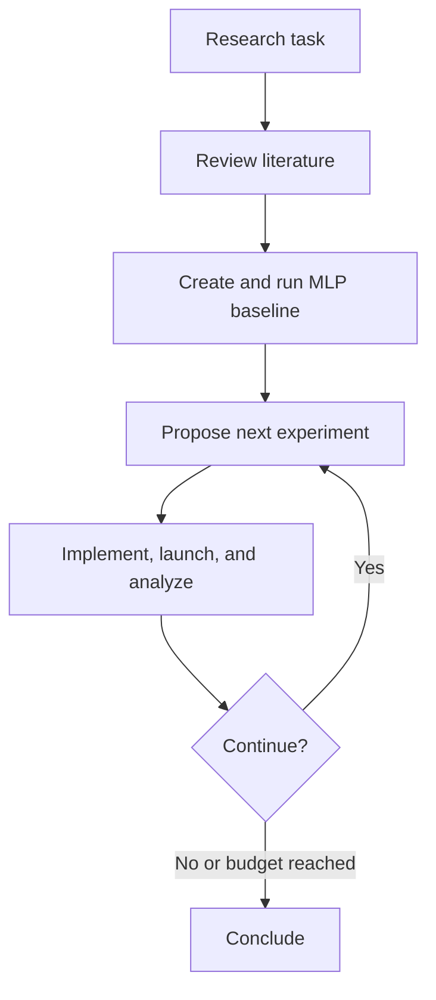

# EuroSAT RGB autoresearch example


*EuroSAT RGB contains 27,000 labeled 64x64 Sentinel-2 image patches across 10 land-cover classes. Source: [`blanchon/EuroSAT_RGB`](https://huggingface.co/datasets/blanchon/EuroSAT_RGB).*

This example demonstrates the full Hiraku research workflow on a small image-classification problem.

The research loop uses literature evidence and experimental results to decide which architectural changes are worth testing next.

The starter contains the data and training scaffold, but no model implementation. The workflow reviews the literature first, implements and runs the flattened-image MLP as the baseline, then uses the review and baseline results to choose follow-up experiments that may improve it.

All experiments use the same dataset split, seed, optimizer settings, and training budget so architectural changes can be compared under a stable evaluation protocol.

W&B records training and validation loss and accuracy after every epoch, together with model parameter count and per-epoch CPU time.

!!! question "Research question"
    Under a fixed number of training epochs, which architectural inductive biases most improve EuroSAT RGB land-cover classification over a flattened-image MLP baseline?

!!! tip "Evaluation and tracking"
    Experiments share the same dataset split, seed, optimizer settings, and training budget. W&B records validation loss and accuracy, parameter count, and per-epoch CPU time.

## Initialize the example

Install Hiraku with its W&B extra in your CLI environment first. From the Hiraku checkout:

```bash
uv tool install --force .
```

Then create and initialize a new project:

```bash
mkdir eurosat-rgb
cd eurosat-rgb

git init

hiraku init --example eurosat-rgb

uv sync
uv run wandb login

git add .
git commit -m "initialize EuroSAT RGB example"
```

The first training run downloads the RGB EuroSAT dataset.

Runs are logged to the `eurosat-rgb` W&B project.

Set `WANDB_ENTITY` when the project belongs to a specific entity.

`WANDB_PROJECT` can be used to override the default project name.

## Install the MCP for literature review

### Claude Code

```bash
claude mcp add --transport http alphaxiv https://api.alphaxiv.org/mcp/v1
```

### Codex

```bash
codex mcp add alphaxiv --url https://api.alphaxiv.org/mcp/v1
```

### Pi

Create an API Key from [alphaXiv](https://www.alphaxiv.org/settings/api-keys) and export it in your shell environment:

```bash
export ALPHAXIV_API_KEY="<key>"
pi mcp add alphaxiv --url https://api.alphaxiv.org/mcp/v1 --bearer-token-env-var ALPHAXIV_API_KEY
```

## Run the full research workflow

After initialization, give a coding agent the prompt below. Select the reusable
`autoresearch` Program as the top-level workflow. It runs the requested
`literature-review` Program first when no suitable task-linked review exists,
then establishes the MLP baseline and runs justified follow-up experiments.
The autoresearch Program defines the experiment budget and stopping rules; the
coding harness controls which operations are permitted.

!!! info "Bounded autonomous run"
    The Program counts every attempted experiment, including failed runs, against its session budget. The Hiraku task's `experiment_budget` value is informational.

```text
Create the Hiraku task `eurosat-rgb` if it does not already exist.

Set the goal to investigate image-specific architectural inductive biases on EuroSAT RGB.
Declare `val/accuracy` as the primary metric to maximize and `val/loss` as a supporting metric to minimize.
Set the tracking backend to be W&B with the project named `eurosat-rgb`.
Record this protocol: EuroSAT RGB at 64x64 resolution, stratified 80/20 train/validation split, seed 42, Adam with learning rate 0.001, batch size 64, 10 epochs, CPU only, and no pretrained models.
Set the task's informational experiment budget to five, including the baseline.

Run the `autoresearch` Program for this task. As its initial phase, use the `literature-review` Program to review image-specific architectural inductive biases for small, CPU-trainable image classifiers without pretraining. Save the review as a task-linked Hiraku Context, including candidate directions, sources, verification status, and limitations. After saving and delivering the review, continue the same workflow directly into the baseline and follow-up experiment loop. Do not stop after the literature review.
Use a maximum of five experiments for this session, including the baseline. Work on one experiment at a time.
```

The `autoresearch` Program should establish the flattened-image MLP baseline if missing, use the saved literature Context to select justified follow-up experiments, and stop when its session budget or another Program stop condition is reached.

## Expected research flow

The example exercises the complete Hiraku workflow:



The task is the root record. The MLP baseline and each follow-up are experiment records under that task.
