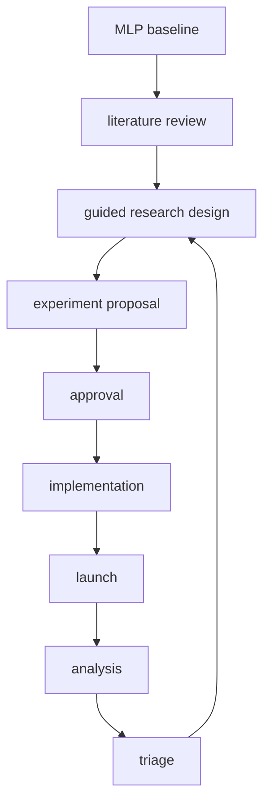

# EuroSAT RGB autoresearch example

This example demonstrates the full Hiraku research workflow on a small image-classification problem that can run on CPU.

The starting point is a flattened-image MLP. The research loop then uses literature evidence and experimental results to decide which architectural changes are worth testing next.

The research question is:

> Under a fixed number of training epochs, which architectural inductive biases most improve EuroSAT RGB land-cover classification over a flattened-image MLP baseline?

The starter implementation contains only the MLP baseline. Follow-up architectures are intentionally not predefined: the literature review and autoresearch loop should motivate and implement them.

All experiments use the same dataset split, seed, optimizer settings, and training budget so architectural changes can be compared under a stable evaluation protocol.

W&B records training and validation loss and accuracy after every epoch, together with model parameter count and per-epoch CPU time.

## Initialize the example

Install Hiraku with its W&B extra in your CLI environment first. From the Hiraku checkout:

```bash
uv tool install --force '.[wandb]'
```

Then create and initialize a new project:

```bash
mkdir eurosat-rgb
cd eurosat-rgb

git init

hiraku init --example eurosat-rgb

uv sync
uv run wandb login

git add .
git commit -m "initialize EuroSAT RGB example"
```

The first training run downloads the RGB EuroSAT dataset with:

```python
torchvision.datasets.EuroSAT(root="data", download=True)
```

The dataset and downloaded archive are ignored by Git.

Runs are logged to the `eurosat-rgb` W&B project. Set `WANDB_ENTITY` when the project belongs to a specific entity. `WANDB_PROJECT` can be used to override the default project name.

## Create the research task

Create the research task with the fixed research question, metrics, and tracking backend:

```bash
hiraku record create eurosat-rgb --type task \
  --set 'goal=Investigate image-specific architectural inductive biases for EuroSAT RGB under a fixed CPU training budget' \
  --set 'question=Under a fixed number of training epochs, which architectural inductive biases most improve EuroSAT RGB land-cover classification over a flattened-image MLP baseline?' \
  --set 'metrics=[{name: val/accuracy, direction: maximize}, {name: val/loss, direction: minimize}]' \
  --set 'tracking_backend={type: wandb, project: eurosat-rgb}'
```

The evaluation protocol is fixed throughout the research loop:

- EuroSAT RGB,
- images at 64×64 resolution,
- stratified 80/20 train/validation split,
- seed 42,
- Adam optimizer,
- learning rate `0.001`,
- batch size `128`,
- 10 training epochs,
- CPU execution only,
- no pretrained models.

Validation accuracy is the primary metric. Validation loss, parameter count, and CPU time are supporting evidence.

## Run the MLP baseline

The starter implementation contains a one-hidden-layer MLP that receives flattened RGB pixels.

Create the baseline record:

```bash
hiraku record create mlp-baseline --parent eurosat-rgb --type experiment \
  --set 'summary=Flattened RGB pixels with a one-hidden-layer MLP' \
  --set 'hypothesis=The flattened-pixel MLP establishes the reference validation accuracy and loss under the fixed training budget' \
  --commit HEAD \
  --set 'entrypoints={train: {command: [uv, run, python, train.py], args: {model: mlp, seed: 42, validation-fraction: 0.2, epochs: 10, batch-size: 128, learning-rate: 0.001}}}'
```

Launch it through Hiraku:

```bash
hiraku launch train --record mlp-baseline
hiraku runs --record mlp-baseline
```

This baseline deliberately ignores the spatial structure of the input images.

## Run the full research workflow

After the baseline is established, ask a coding agent to continue the investigation using the Hiraku Programs.

```text
Use Hiraku to investigate the `eurosat-rgb` research task.

Start with the `literature-review`.

Review relevant literature on architectural inductive biases for small image
classification models, focusing on approaches that can be trained quickly on
CPU and compared fairly with a flattened-image MLP.

Identify evidence-backed architectural directions that may improve EuroSAT RGB
classification without pretrained models.

Keep the existing `mlp-baseline` run as the reference and preserve the fixed
evaluation protocol:

- EuroSAT RGB,
- 64x64 RGB input,
- stratified 80/20 train/validation split,
- seed 42,
- Adam optimizer,
- learning rate 0.001,
- batch size 128,
- 10 training epochs,
- validation accuracy as the primary metric,
- validation loss as a supporting metric,
- CPU only,
- no pretrained models.

Prefer architectural hypotheses and image-specific inductive biases over broad
hyperparameter search.

Select one of the identified directions and run an `autoresearch` loop.

Run one focused experiment at a time and perform at most 5 experiments beyond
the MLP baseline.

For each experiment:

- formulate one falsifiable hypothesis,
- implement only the approved architectural change,
- launch it through Hiraku,
- analyze attributed runs against the stated hypothesis,
- record supported, refuted, and inconclusive results,
- use triage to decide whether another experiment is justified.

Each next experiment should be motivated by literature evidence or by results
already recorded in this task.

Do not change the evaluation protocol during the loop.

Stop when:

- the five-experiment budget is exhausted,
- no justified follow-up remains,
- the research question has been answered sufficiently,
- or a new user decision is required.
```

The example deliberately does not prescribe which architecture should be tried after the MLP.

## Expected research flow

The example exercises the complete Hiraku workflow:

