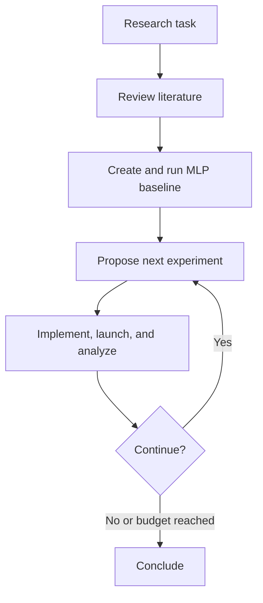

# EuroSAT RGB autoresearch example


*EuroSAT RGB contains 27,000 labeled 64x64 Sentinel-2 image patches across 10 land-cover classes. Source: [`blanchon/EuroSAT_RGB`](https://huggingface.co/datasets/blanchon/EuroSAT_RGB).*

This example demonstrates the full Hiraku research workflow on a small image-classification problem.

The research loop uses literature evidence and experimental results to decide which architectural changes are worth testing next.

The starter implementation contains only the MLP baseline. Follow-up architectures are intentionally not predefined: the literature review and autoresearch loop should motivate and implement them.

All experiments use the same dataset split, seed, optimizer settings, and training budget so architectural changes can be compared under a stable evaluation protocol.

W&B records training and validation loss and accuracy after every epoch, together with model parameter count and per-epoch CPU time.

!!! question "Research question"
    Under a fixed number of training epochs, which architectural inductive biases most improve EuroSAT RGB land-cover classification over a flattened-image MLP baseline?

!!! info "Starting point"
    The starter implementation contains only the flattened-image MLP baseline. Follow-up architectures are chosen from literature evidence and experimental results.

!!! tip "Evaluation and tracking"
    Experiments share the same dataset split, seed, optimizer settings, and training budget. W&B records validation loss and accuracy, parameter count, and per-epoch CPU time.

## Initialize the example

Install Hiraku with its W&B extra in your CLI environment first. From the Hiraku checkout:

```bash
uv tool install --force .
```

Then create and initialize a new project:

```bash
mkdir eurosat-rgb
cd eurosat-rgb

git init

hiraku init --example eurosat-rgb

uv sync
uv run wandb login

git add .
git commit -m "initialize EuroSAT RGB example"
```

The first training run downloads the RGB EuroSAT dataset.

Runs are logged to the `eurosat-rgb` W&B project.

Set `WANDB_ENTITY` when the project belongs to a specific entity.

`WANDB_PROJECT` can be used to override the default project name.

## Install the MCP for literature review

### Claude Code

```bash
claude mcp add --transport http alphaxiv https://api.alphaxiv.org/mcp/v1
```

### Codex

```bash
codex mcp add alphaxiv --url https://api.alphaxiv.org/mcp/v1
```

### Pi

Create an API Key from [alphaXiv](https://www.alphaxiv.org/settings/api-keys) and export it in your shell environment:

```bash
export ALPHAXIV_API_KEY="<key>"
pi mcp add alphaxiv --url https://api.alphaxiv.org/mcp/v1 --bearer-token-env-var ALPHAXIV_API_KEY
```

## Run the full research workflow

After initialization, give a coding agent the prompt below. The prompt defines
the sequence across the reusable `literature-review` and `autoresearch`
Programs. The user's explicit instruction to continue into autoresearch is the
handoff after the literature review.

!!! info "Bounded autonomous run"
    The prompt explicitly authorizes the complete loop, so the agent does not pause for per-experiment approval. It must stop at the experiment limit or if it needs a decision outside the authorization.

```text
Complete the EuroSAT RGB research workflow in this project.

Create a Hiraku task named `eurosat-rgb`, if non-existing, for investigating image-specific architectural inductive biases on EuroSAT RGB.
Declare `val/accuracy` as the primary metric to maximize and `val/loss` as a supporting metric to minimize.
Use W&B project `eurosat-rgb`.

Use the following protocol: EuroSAT RGB at 64x64 resolution, stratified 80/20 train/validation split, seed 42, Adam with learning rate 0.001, batch size 64, 10 epochs, CPU only, and no pretrained models.
Record this protocol and a total experiment budget of five, including the baseline, on the task.

Create and launch the flattened-image MLP baseline through Hiraku if it does not already exist.
Then do a literature review to review architectural inductive biases for small image classification models.
Focus on approaches that train quickly on CPU and can be compared fairly with the MLP.
Identify evidence-backed directions that may improve EuroSAT RGB classification without pretrained models.
After delivering the review, run an autoresearch loop until the budget is reached, no justified experiment remains, a run or project constraint blocks safe progress, or continuing would require changing the research question, metrics, protocol, or authorized scope.
```

## Expected research flow

The example exercises the complete Hiraku workflow:



The task is the root record. The MLP baseline and each follow-up are experiment records under that task.
