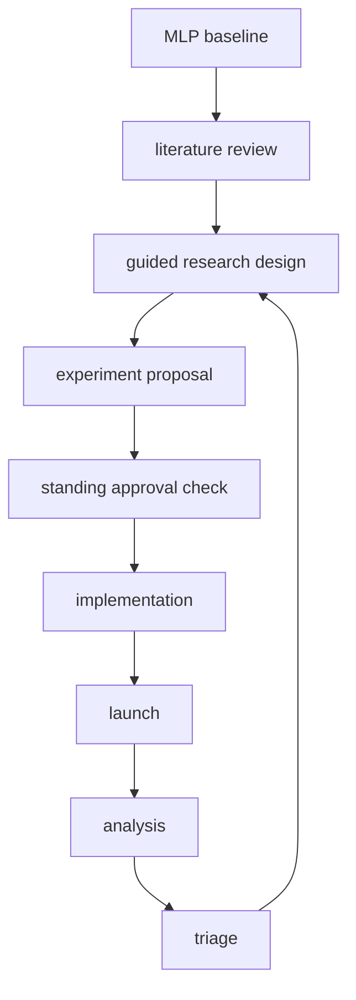

# EuroSAT RGB autoresearch example

This example demonstrates the full Hiraku research workflow on a small image-classification problem that can run on CPU.

The research loop then uses literature evidence and experimental results to decide which architectural changes are worth testing next.

The research question is:

> Under a fixed number of training epochs, which architectural inductive biases most improve EuroSAT RGB land-cover classification over a flattened-image MLP baseline?

The starter implementation contains only the MLP baseline. Follow-up architectures are intentionally not predefined: the literature review and autoresearch loop should motivate and implement them.

All experiments use the same dataset split, seed, optimizer settings, and training budget so architectural changes can be compared under a stable evaluation protocol.

W&B records training and validation loss and accuracy after every epoch, together with model parameter count and per-epoch CPU time.

## Initialize the example

Install Hiraku with its W&B extra in your CLI environment first. From the Hiraku checkout:

```bash
uv tool install --force .
```

Then create and initialize a new project:

```bash
mkdir eurosat-rgb
cd eurosat-rgb

git init

hiraku init --example eurosat-rgb

uv sync
uv run wandb login

git add .
git commit -m "initialize EuroSAT RGB example"
```

The first training run downloads the RGB EuroSAT dataset.

Runs are logged to the `eurosat-rgb` W&B project. Set `WANDB_ENTITY` when the project belongs to a specific entity. `WANDB_PROJECT` can be used to override the default project name.

## Run the full research workflow

After initialization, give a coding agent the prompt below. It directs the agent to create the task and baseline, conduct the literature review, then run the bounded autoresearch loop. It explicitly authorizes the complete loop so the agent does not pause for per-experiment approval. The agent must still stop if it reaches the experiment limit or needs a decision outside the authorization.

```text
Complete the EuroSAT RGB research workflow in this project. Resume existing work if the task or baseline already exists; do not create duplicates.

Create a Hiraku task named `eurosat-rgb` for investigating image-specific architectural inductive biases on EuroSAT RGB. Declare `val/accuracy` as the primary metric to maximize and `val/loss` as a supporting metric to minimize. Use W&B project `eurosat-rgb`.

Use the following protocol: EuroSAT RGB at 64x64 resolution, stratified 80/20 train/validation split, seed 42, Adam with learning rate 0.001, batch size 64, 10 epochs, CPU only, and no pretrained models. Record this protocol and a total experiment budget of five, including the baseline, on the task.

Create and launch the flattened-image MLP baseline through Hiraku if it does not already exist. Then use the `literature-review` Program to review architectural inductive biases for small image classification models. Focus on approaches that train quickly on CPU and can be compared fairly with the MLP. Identify evidence-backed directions that may improve EuroSAT RGB classification without pretrained models. After delivering the review, continue directly to the `autoresearch` Program; do not stop after the review.

I authorize the complete bounded loop: run up to five experiments total, counting the baseline. This is standing approval for each experiment that the `autoresearch` Program judges evidence-backed, within the task's question and evaluation protocol, and within the stated budget. Create, implement, commit, launch through Hiraku, and analyze one experiment at a time. Do not ask me for per-experiment approval. Do not create speculative future experiment records. Stop when the budget is reached, no justified experiment remains, a run or project constraint blocks safe progress, or continuing would require changing the research question, metrics, protocol, or authorized scope. Report the review, records, run results, and final conclusions.
```

The example deliberately does not prescribe which architecture should be tried after the MLP baseline. The literature review and observed results determine the next experiment.

## Expected research flow

The example exercises the complete Hiraku workflow:


