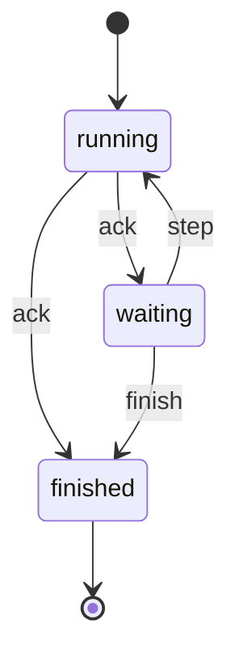

# Workflow examples

The `workflow-examples` example installs three small workflows next to the
bundled `collaborative` workflow. None does research work, so you can use them
to try out a new harness, model, or MCP setup before running a real workflow,
and as starting points for your own:

- [`count-steps`](#count-steps), a Python workflow that checks whether a coding
  harness follows Hiraku workflow instructions exactly;
- [`greet`](#greet), a prompt-only workflow whose arguments fill placeholders
  in its `workflow.md`;
- [`scheduler`](#scheduler), a Python workflow that picks its next step from
  the project's records, by priority.

## Initialize

In a Git repository, install the example and restart your coding agent so it
loads the `hiraku` MCP server:

```bash
hiraku init --example workflow-examples
```

## Count steps

The workflow is `hiraku/workflows/count-steps/`. Its `## Step` section
contains `{{step}}`, `{{count}}`, and `{{token}}` placeholders, which `next`
fills with `hiraku.markdown.render`, so the agent receives the exact line to
print.

### Run

Invoke the MCP prompt `hiraku:count-steps` (or raw: `/mcp__hiraku__count-steps`) in Claude Code. Note: Codex does not support MCP prompts.

Alternatively, ask your agent (which will invoke the MCP tool) to run the workflow:

> Start the Hiraku count-steps workflow with count 3.

The workflow sends `count` numbered steps (default 5). Each step carries a
fresh random token, and the agent must:

1. print the step line to you, for example `Step 2/3: token 1a2b3c4d`;
2. send the event `ack` with that step's token.

After each step the agent tells you how many steps remain and asks whether to
run the next one. It sends `step` only after you agree, or `finish` to stop.
After the last step, or after `finish`, the session completes with a final
instruction: the agent tells you how many steps ran.

Its states and events, from `hiraku workflow graph count-steps`:



The agent acknowledges a running step; at the `waiting` gate you go on or
finish, so the agent cannot end the session on its own.

### What to look for

- **Every step is printed in order.** A wrong, stale, or invented token is
  rejected, so a skipped or repeated step shows up as a rejected event.
- **The agent stops after every step** and waits for your answer. Hiraku cannot
  enforce this: an agent that sends `step` without asking fails the check
  even though the workflow accepts the event.
- **The session completes.** Run `hiraku session list` to see its state, or
  `hiraku session show <session-id>` for the accepted calls.

To test recovery, compact or restart the conversation mid-run and ask the agent
to continue the session; it should resume at the current step.

### Run from the terminal

`hiraku-agent` runs the same workflow one step at a time with a headless
agent, `claude -p` by default:

```bash
hiraku-agent count-steps --count 3   # start and run step 1
hiraku-agent count-steps step        # run the next step
hiraku-agent count-steps finish      # or stop early
```

Each step starts a new agent process with an empty conversation: it knows only
its prompt, which it gets on standard input. The agent prints the step line,
writes its `ack` event with the token to a file, and exits; the driver checks
the event and stops at the next user decision. The prompt and event of each
step are kept under `hiraku/sessions/<session-id>/<instruction-id>/`, so you
can inspect what the agent saw.

Add `--interactive`, e.g. `hiraku-agent count-steps step --interactive`, to run
the step as a conversation with the agent in your terminal instead: the agent
says what it would do and waits for your go-ahead, and the driver still stops
before the next step.

## Greet

`hiraku/workflows/greet/workflow.md` is the whole workflow; there is no
`workflow.py`:

```markdown
---
id: greet
description: Greet someone a few times; a prompt-only workflow with arguments.
arguments:
  name: {required: true, description: Who to greet}
  times: {type: integer, default: 2, description: How many greetings to print}
  formal: {type: boolean, default: false, description: Whether to greet formally}
---
# Greet

Print {{times}} greetings to {{name}}, one per line. Greet formally:
{{formal}}. Do not change any files.
```

Each `{{name}}` placeholder needs a declared argument, so a typo is an error
when the workflow loads. Start it with the MCP prompt
`/mcp__hiraku__greet name=Ada times=3`, by asking your agent to greet Ada with
the Hiraku greet workflow, or from the terminal:

```bash
hiraku-agent greet --name Ada --formal true
```

Hiraku validates and converts the arguments, renders the body, and sends it as
the session's only instruction. That instruction is final: the session
completes when it starts, so there is no event to send, and the agent just
prints the greetings. Copy the directory to turn your own prompt into a
workflow.

## Scheduler

The workflow is `hiraku/workflows/scheduler/`. Its next step does not follow a
fixed sequence; it comes from the records in the project:

1. `start` creates a task record `scheduler-<id>` and `records` experiment
   records below it (default 3), each with a random `priority` from 1 to 9 and
   `count: 0`.
2. Hiraku assigns the open record with the highest priority, ties going to the
   larger ID. A record is open while its `count` is below `target` (default 2).
3. The agent raises the assigned record's `count` by one, with
   `hiraku record update <record> --set count=<n>` or the `record_update`
   tool, and sends the event `incremented` with the record ID.
4. Hiraku checks the evidence: the event must name the assigned record, and its
   count must be exactly one higher than when it was assigned. Then it assigns
   the next record.
5. When every count reaches `target`, a final instruction asks the agent to show
   you the records.

There is no user gate, so the agent works on its own:

```bash
hiraku-agent scheduler --records 3 --target 2   # six steps, one agent each
hiraku record tree                               # the records and their counts
```

Assigning a record is a decision, so `start` and the `incremented` event make
it and store it in the session's state; `next` only shows the assignment. An
event can then be checked against what the agent was told, and `session_show`
returns the same assignment until the agent reports it.
