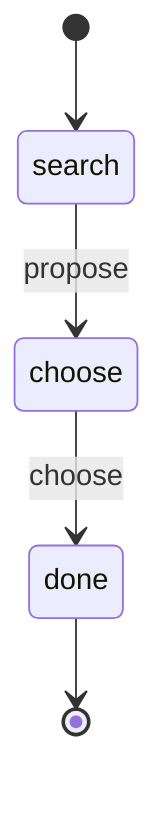

# Workflows

Workflows turn a research procedure into a sequence of explicit steps that your
coding agent carries out, in your normal conversation over MCP or from a
terminal with `hiraku-agent`. Python code in your
project decides what happens next and checks what the agent reports, so
budgets, candidate lists, launch approvals, and evidence are enforced instead
of left to the agent's memory.

A workflow consists of three concepts:

- **Workflow**: a directory `hiraku/workflows/<workflow-id>/`. `workflow.md`
  is the workflow's record: front matter with its `id` and settings, and a body
  with its prompts. `workflow.py` defines its class, which adds the operations.
- **Session**: one invocation of a workflow, stored in
  `hiraku/sessions/<session-id>.json`. It holds the workflow's state, the
  history of accepted calls, and the current instruction, so work continues
  after a restart.
- **Instruction**: the next request to the agent. It contains guidance,
  concise context, whether the user must answer first, and the events it
  accepts, each with its argument schema. The final instruction accepts no
  events: it ends the session, and its context is the session's result. The
  agent still carries it out, for example by summarizing the results for you.
- **State**: where a session is, such as `draft` or `waiting`. Each state has
  one instruction. A session begins in the start state and ends in a final
  state, whose instruction is the final one.
- **Event**: what moves a session from a state to another: a report from the
  agent, such as `implemented` with a commit, or a decision of yours, such as
  `step`. The workflow checks each event and may reject it.

The terms come from state machines, and every workflow can be drawn as one
(see [States and graphs](#states-and-graphs)). Workflow code stays plain
Python, though: methods declare the states and events.

## Use a workflow

`hiraku init` installs the bundled workflows and registers the Hiraku MCP
server for Claude Code (`.mcp.json`) and Codex (`.codex/config.toml`). The
server runs `hiraku mcp`, so the `hiraku` command must be on the agent's
`PATH`. Each workflow is available in two ways under its ID:

- as an **MCP prompt** that you invoke yourself, which agents such as Claude
  Code show as a slash command, e.g. `/mcp__hiraku__collaborative`. Its
  arguments are typed in the command; the prompt starts a session and hands its
  first instruction to the agent.
- as an **MCP tool** that the agent calls when you ask for the workflow, e.g.:

  > What Hiraku workflows are available here? Start collaborative research on
  > the active task, at most two experiments.

  The agent calls `workflow_list` to explain the workflows, then the
  `collaborative` tool. Codex has no MCP prompts, so this is how it starts
  workflows.

Every instruction has text, context, and, unless it is final, an `events`
block that says which events it accepts: whether you must answer first, the
accepted events with their argument schemas, and the session and instruction
IDs to pass. The agent sends one with the `workflow_send_event` tool, for
example `workflow_send_event(event="revise", arguments={"feedback": "Keep SGD"},
...)`:

```json
{
  "status": "accepted",
  "session_id": "collaborative-3f9a1c2b4d5e",
  "instruction_id": 2,
  "instruction": {
    "text": "## Review\n\nPresent the result of the step in the context ...",
    "context": {
      "step": "draft",
      "result": {"record_id": "exp-wd", "summary": "Add weight decay", ...},
      "rounds_left": 3
    },
    "events": {
      "tool": "workflow_send_event",
      "session_id": "collaborative-3f9a1c2b4d5e",
      "instruction_id": 2,
      "requires_user_response": true,
      "accepted": [
        {"event": "implement", "description": "Implement the drafted experiment.",
         "arguments": {"properties": {}}},
        {"event": "revise", "description": "Redo the reviewed step with ...",
         "arguments": {"properties": {"feedback": {"type": "string"}},
                       "required": ["feedback"]}},
        {"event": "finish", "description": "End the session and summarize ...",
         "arguments": {"properties": {}}}
      ]
    }
  }
}
```

When `events.requires_user_response` is true, the agent asks you before
sending an event. This is a conversational contract; it does not authenticate
approval. The `workflow_send_event` tool's description explains this protocol
to the agent. An MCP prompt hands over the instruction as text with its context
and events block, and ends with a line saying to send an event with
`workflow_send_event`: the prompt arrives as a user message, and without that
line agents may answer in the chat, which never reaches the workflow.

An event passes the `instruction_id` of the instruction it answers, so a late
or repeated call cannot be applied to a later step. `session_id` may be left
out while only one session is active. Hiraku checks the event's arguments
against its schema and keeps each accepted call in the session's history.

An event has one of these outcomes:

| Status | Meaning |
| --- | --- |
| `accepted` | The event was applied; the response holds the next instruction. With `completed: true`, it is the final instruction, which accepts no events. |
| `rejected` | The input was invalid; the same instruction stays current. |
| `not_ready` | The input was valid, but the evidence it refers to has not arrived yet; check again later. |
| `stale` | The event answers an instruction that is no longer current; the call was not applied, and the response holds the current instruction. |

Sending an identical event again is safe: it returns the same response without
applying the event again.

Completion means the session accepts no more events, not necessarily that
every objective was met: the final instruction's context distinguishes, for
example, completed, partial, and stopped results.

### Resume, inspect, and cancel

Sessions are stored on disk, so a restarted MCP server or a new conversation
continues where the session stopped. Ask the agent to resume the session; it
uses `session_list` and `session_show` to get the current instruction. From a
terminal:

```bash
hiraku session list
hiraku session show <session-id>
hiraku session cancel <session-id>
```

Cancelling stops the session from accepting events. It never reverts code,
deletes records, or stops processes that are still running.

Hiraku resumes the last saved instruction and never applies an accepted event
twice. Work the agent did before sending an event, such as creating records or
launching runs, is not rolled back; workflows tell the agent to check for
existing outputs before repeating such work.

### Tools and prompts are fixed

The MCP server offers one tool and one prompt per workflow, the generic
`workflow_send_event`, and the tools below, all fixed when it starts: coding agents
do not reliably pick up tools that change during a session. A workflow added or
edited later appears after you reconnect the Hiraku MCP server or restart the
agent.

### Workflow and session tools

Besides the tool named after each workflow and `workflow_send_event`, the
server offers `workflow_list`, `session_list`, `session_show`, and
`session_cancel`, and resources for workflow documents
(`hiraku://workflows/<id>`), workflow graphs (`hiraku://workflows/<id>/graph`),
and sessions (`hiraku://sessions/<id>`). The server's record, context, and run tools are
described in the [MCP server guide](mcp.md).

The bundled workflows launch experiments with the `hiraku launch` CLI rather
than the `launch_entrypoint` tool: MCP clients limit how long a tool call may
run and how much output it may return. The server's environment and working directory come
from the agent's MCP configuration, not from the agent's shell.

## Run a workflow from the terminal

`hiraku-agent` runs the same sessions from a terminal. It hands each current
instruction to a coding agent and stops whenever you decide:

```bash
hiraku-agent count-steps --count 3   # start; the agent runs step 1
hiraku-agent count-steps step        # you go on; the agent runs step 2
hiraku-agent count-steps finish      # or you stop
```

Each workflow is a command whose options are its start arguments, and each
event is a subcommand whose options are the event's arguments; see
`hiraku-agent count-steps --help`. Text arguments are passed as given, other
values are parsed as JSON, and the workflow validates them.

- `hiraku-agent WORKFLOW` starts a session, or resumes the workflow's active
  session. Pass `--new` to start another one and `--session` to choose one.
- `hiraku-agent WORKFLOW EVENT` sends `EVENT` to the current instruction of
  the active session that accepts it, then continues.
- For every other instruction, the driver writes a prompt to
  `hiraku/sessions/<session-id>/<instruction-id>/<attempt>/prompt.md` and runs
  the agent. The agent writes its event as JSON to the `event.json` named in
  the prompt. A rejected event goes back to the agent with the error, up to
  `--retries` times.
- At an instruction that requires your response, the driver prints its context
  and the event commands and exits with status 3. An event that is not ready,
  such as a launch whose run is not tracked yet, is kept: the next
  `hiraku-agent WORKFLOW` sends it again without the agent, and exits with
  status 4 while it still waits. The agent carries out the final instruction
  without writing an event, and the driver exits with 0.
- With `--interactive`, each agent step runs as a conversation with you in the
  terminal instead of headless: the agent first says what it would do and
  waits; discuss the step, and once you tell it to go ahead it carries out the
  step and writes the event. The driver still stops where you decide, so
  `hiraku-agent count-steps step --interactive` is exactly one conversational
  step. Exit the agent without an event to stop; the instruction stays current.

| Mode | Default command | Override |
| --- | --- | --- |
| Headless | `claude -p --allowedTools ...` | `HIRAKU_AGENT_CMD` or `--agent-cmd` |
| Interactive | `claude --allowedTools ... --` | `HIRAKU_AGENT_INTERACTIVE_CMD` or `--agent-cmd` |

The default commands let the agent read, write, and edit files and run shell
commands, which steps such as implementing or launching need; an override is
used as given. The
prompt arrives on standard input, or with `--interactive` as an opening
message appended as the last argument, so an interactive command must accept a
prompt there (the default ends its options with `--`), and the environment holds `HIRAKU_EVENT_FILE`
(except for the final instruction), `HIRAKU_PROMPT_FILE`, `HIRAKU_SESSION_ID`,
and `HIRAKU_INSTRUCTION_FILE`, the response with the instruction as JSON. A
script can therefore stand in for the agent.

Sessions are shared with the MCP server: start a session in Claude Code and
continue it later with `hiraku-agent <workflow> --session <session-id>` from a
terminal.
The instruction ID and a per-session lock keep the two from applying
conflicting events.

## Write a Markdown-only workflow

The simplest workflow is a directory with only `workflow.md`. Its front matter
may declare arguments, which fill `{{name}}` placeholders in the body:

```markdown
---
id: literature-scan
description: Scan recent papers on the task and summarize them in a context.
arguments:
  topic: {required: true, description: What to search for}
  years: {type: integer, default: 2, description: How far back to search}
---
# Literature scan

Search for papers on {{topic}} from the last {{years}} years ...
```

Argument types are `string` (the default), `integer`, `number`, and `boolean`.
A placeholder without a declared argument is an error when the workflow loads.

`/mcp__hiraku__literature-scan topic=diffusion years=3` and the
`literature-scan` tool both start a session whose only instruction is the
rendered body. Prompt arguments arrive as text and are converted to the
declared types. That instruction is final: the session completes when it
starts, and the agent then carries out the prompt. `session_show` still
returns it, so a new conversation can read it again.

Hiraku checks nothing about the work in a Markdown-only workflow: there are no
events, budgets, approvals, or evidence checks. Add a `workflow.py` when you
need such checks; the `workflow.md` stays the same record.

## Write a workflow

Create `hiraku/workflows/<workflow-id>/workflow.py` exporting `WORKFLOW`, and a
`workflow.md` with the prompts:

```python
from typing import Annotated

from pydantic import BaseModel, Field

from hiraku.errors import EventRejected
from hiraku.workflow import Instruction, Workflow, event, state


class Questions(BaseModel):
    topic: str
    candidates: list[str] = []
    chosen: str | None = None


class Review(Workflow):
    """Search the literature and choose a research question with the user."""

    min_questions: int = 2  # setting; override it in the front matter

    def start(
        self, topic: Annotated[str, Field(description="Research topic.")]
    ) -> Questions:
        """Start a literature review."""
        return Questions(topic=topic)

    @state("search", start=True)
    def searching(self, questions: Questions) -> Instruction:
        return Instruction(
            self.markdown.section("## Search"), context={"topic": questions.topic}
        )

    @state("choose")
    def choosing(self, questions: Questions) -> Instruction:
        return Instruction(
            self.markdown.section("## Choose"),
            context={"candidates": questions.candidates},
            requires_user_response=True,
        )

    @state("done", final=True)
    def confirming(self, questions: Questions) -> Instruction:
        return Instruction(
            self.markdown.section("## Done"), context={"question": questions.chosen}
        )

    @event(source="search", dest="choose")
    def propose(self, questions: Questions, candidates: list[str]) -> None:
        """Submit candidate research questions."""
        if len(candidates) < self.min_questions:
            raise EventRejected(f"Propose at least {self.min_questions} questions")
        questions.candidates = candidates

    @event(source="choose", dest="done")
    def choose(self, questions: Questions, question: str) -> None:
        """Record the question the user chose."""
        if question not in questions.candidates:
            raise EventRejected(f"Choose one of {questions.candidates}")
        questions.chosen = question


WORKFLOW = Review
```

```markdown
---
id: review
min_questions: 3
---
# Literature review

## Search

Search the literature on the topic, then send the event `propose` with
candidate research questions.

## Choose

Present the candidates and ask the user which one to pursue. Send the event
`choose` with the question they pick.

## Done

Confirm the chosen question to the user.
```

The rules are deliberately small:

- A `Workflow` instance is the loaded `workflow.md` record. Its front matter
  needs the workflow `id`, matching the directory name. Workflow IDs use
  letters, digits, and `-`, so the MCP tool named after a workflow never
  collides with Hiraku's own tools such as `workflow_send_event`. Annotated
  class attributes, like `min_questions` above, are settings validated from the
  front matter; other front-matter fields are kept as metadata. The class body
  follows Pydantic rules: constants need `ClassVar[...]`, and `__init__` is not
  overridden.
- `start` handles the start arguments: its signature and docstring define how
  the workflow is started, and they become the MCP tool and prompt named after
  the workflow. Use `Annotated[..., Field()]` for parameter descriptions and
  constraints. `start` returns the workflow's **data**, a Pydantic model you
  define and name after what it holds, like `Questions` above. The data is
  stored as JSON in the session, so its fields must be JSON-serializable. A
  workflow without data declares `def start(...) -> None`.
- `@state("name")` declares a state, and the method builds its `Instruction`.
  Exactly one state has `start=True`, where sessions begin, and at least one
  has `final=True`; a final state's instruction is the session's last, and its
  context is the session's result. A state method may read records and runs,
  but must not change the data; Hiraku reports a change as an error.
- `@event(source=..., dest=...)` declares an event: the states that accept it
  and the states it moves to. Its other parameters and docstring define the
  event's arguments and description. An event changes the data in place. With
  one destination it returns nothing, and with several it returns the state it
  chooses, e.g. `return "done" if finished else "waiting"`. Hiraku checks that
  the current instruction accepts the event and that its arguments match,
  calls the event, enters the destination state, and saves the result
  atomically. A state or event method cannot be named `start` or like a
  `Workflow` method such as `save`.
- State and event methods take the data as their first parameter, annotated
  with the model `start` returns; in a workflow without data, they take none.
- Raise `EventRejected` for invalid input and `NotReady` when valid input
  refers to evidence that has not arrived yet, in an event or in a state
  method. Nothing is saved in either case. A valid alternative, such as
  skipping or stopping, is a normal event.
- `self.markdown.section("## Search")` returns a section of this workflow's
  `workflow.md`, including its subsections, and `self.text` the whole body.
  Select a section by its heading line as written: the level must match, so
  `"### Search"` is a different section. Headings in code blocks, lists, and
  block quotes do not start sections, and each heading may appear only once in
  a `workflow.md`. To fill `{{name}}` placeholders in a section, pass it to
  `hiraku.markdown.render(text, values)`; a placeholder without a value is an
  error. Hiraku sends only the instruction text you pass, so each
  instruction must stand on its own: text before the first `##` heading is not
  sent. To repeat guidance in several instructions, declare it as a setting,
  as the bundled `collaborative` workflow does with `rules`, and add it to the
  instruction text.
- Each call gets a fresh copy of the loaded workflow, bound to the project
  configuration as currently saved; changing `self` during a
  call is not persisted. To run a workflow from Python, for example in a
  test, load it with `hiraku.workflow.load_workflow()`, bind it with
  `workflow.bind(config)`, and call `run_start({...})` and
  `run_event(session_id, instruction_id, "propose", {...})`.
- Use `self.config` and the Hiraku Python API to read and verify records and
  runs. Prefer events that name records or runs, which the workflow loads and
  checks, over events that carry results as free text.
- Workflow modules can import helpers from their own directory with relative
  imports.

The MCP server loads workflow code and prompts when it starts. A workflow that
fails to load is logged to the server's stderr and left out;
`hiraku workflow list` in a terminal shows the error. After editing a workflow,
reconnect the MCP server. Existing sessions
continue with the new code if their state is still declared, their stored data
still validates against the data model, and their pending events still exist;
otherwise their events
are rejected, and they remain inspectable.
Keep workflows compatible with existing sessions, or start new ones.
Workflow code is trusted project code: loading it executes it.

Test a workflow without an agent with `hiraku workflow start` and
`hiraku workflow send-event`, which print the JSON responses:

```bash
echo '{"topic": "protein folding"}' | hiraku workflow start review --arguments-file -
echo '{"candidates": ["Q1", "Q2"]}' | hiraku workflow send-event <session-id> propose --instruction-id 1 --arguments-file -
```

### States and graphs

Hiraku owns a session's current state: a session begins in the start state,
and only declared events move it, to one of their destinations. Each
instruction accepts the events whose `source` names its state, so a state
method lists none. It may narrow them, e.g.
`Instruction(..., events=[self.finish])` while a step is not available yet;
listing an event the state does not accept is an error.

When a workflow loads, Hiraku checks its states and events: each state is
declared once, exactly one is the start state and at least one is final,
every state an event names exists, a final state accepts no events and every
other state accepts at least one, and every state can be reached from the
start state. Then it draws the workflow as a Mermaid state diagram, with one
edge per event:

```bash
hiraku workflow graph review
hiraku workflow graph collaborative --session <session-id>   # highlight its state
```



The MCP server serves the same diagram as `hiraku://workflows/<id>/graph`, and
`hiraku session show` prints a session's current state.

## Bundled workflows

`hiraku init` installs **collaborative**, which runs experiments on a task in
four states: draft, implement, launch, and analyze. The agent does each step,
shows you the result and revises it with you, and reports it with an event such
as `drafted` or `implemented` once you approve; Hiraku writes the experiment
record, binds the resolved commit, checks that the runs are attributed to the
experiment and its commit, and records the verdict. After `rounds`
experiments, or when you ask to `finish`, the agent summarizes the results.
The approval happens in the conversation, so use collaborative over MCP or
with `hiraku-agent --interactive`; a headless agent has no one to ask.

Two examples add more workflows:

- the [workflow examples](../examples/workflow-examples/README.md) install
  `count-steps`, a small Python workflow that checks a coding harness,
  `greet`, a prompt-only workflow with arguments, and `scheduler`, which picks
  its next step from records by priority;
- the [autoresearch example](../examples/autoresearch/README.md) installs
  `autoresearch`, a Markdown-only workflow with the upstream "experiment until
  stopped" procedure.
