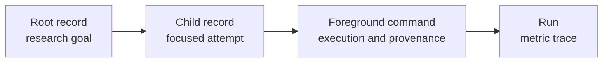

<div class="sdsc-hero">
<p class="sdsc-kicker">Swiss Data Science Center · Hiraku</p>

<h1>Research, made traceable</h1>

Hiraku gives data-science teams a small, scriptable loop for defining a goal,
testing an idea, and keeping the evidence.

<a class="md-button" href="examples/heart-disease/">Run your first experiment</a>
</div>

<div class="sdsc-flow">
<div class="sdsc-flow-step">

<h3>Define</h3>

A research question, metric, and evaluation protocol.
</div>
<div class="sdsc-flow-step">

<h3>Experiment</h3>

Small, reproducible units track the research progress.
</div>
<div class="sdsc-flow-step">

<h3>Learn</h3>

Launch commands, compare runs, and keep the research history visible.
</div>
</div>


## Installation

From a Hiraku source checkout, install the CLI with the optional adapters you
need:

```bash
uv tool install --force '.[mlflow,wandb]'
hiraku --help
```

The MLflow and W&amp;B extras are optional. Use `uv tool install .` if you only
need Hiraku's core CLI. `--force` replaces an existing tool installation, which
is useful when reinstalling from a checkout after code changes that did not
change the package version; it can be omitted for a first install.

For Hiraku development, install the full environment and run the checkout
directly:

```bash
uv sync --all-extras
uv run hiraku --help
```


## The Hiraku workflow

Hiraku connects research records, command executions, and tracked measurements:



* A root `Record` may define a research goal and metrics. Project-wide
  settings, including the tracking backend, live in `hiraku.yml`. The record
  lives at `hiraku/records/{root-id}/{root-id}.md`.
* A child `Record` may focus on an experiment, diagnosis, or review. It inherits through `parent_id` and may bind its own code commit.
* A `Run` records one execution attributed to a `record_id`. Runs are managed by CSV, MLflow, W&B, or another backend and queried by Hiraku.
* `hiraku run` executes in the current working tree, streams output, and returns the command's exit code. Optional dispatch scripts can prepare its runtime.

??? tip "Branching and experiment lineage"
    Git remains responsible for commits, branches, and source history.
    Branches are optional for the core workflow.

### Start here

Follow the [heart disease example](examples/heart-disease/README.md) for a complete workflow.

For a preview of a fully agentic workflow, see the [autoresearch example](examples/autoresearch/README.md).

For more details, see [Essential concepts](concepts.md).

## Documentation

<div class="sdsc-card-grid">
<div class="sdsc-card">

<h3>Examples</h3>

Run complete workflows with CSV, W&B, and MLflow.

<a href="examples/">Browse examples</a>
</div>
<div class="sdsc-card">

<h3>Guides</h3>

Set up a project, choose a tracking backend, or connect an AI agent.

<a href="guides/">Read the guides</a>
</div>
<div class="sdsc-card">

<h3>API</h3>

Look up CLI commands and the Python API when you need exact details.

<a href="api/cli/">CLI</a> · <a href="api/python/">Python API</a>
</div>
</div>
