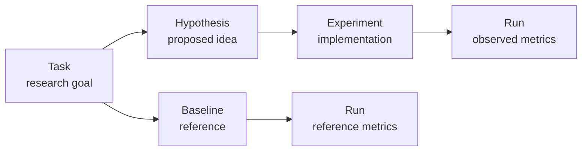

<div class="sdsc-hero">
<p class="sdsc-kicker">Swiss Data Science Center · Hiraku</p>

<h1>Research, made traceable</h1>

Hiraku gives data-science teams a small, scriptable loop for defining a goal,
testing an idea, and keeping the evidence.

<a class="md-button" href="examples/heart-disease/">Run your first experiment</a>
</div>

<div class="sdsc-flow">
<div class="sdsc-flow-step">

<h3>Define</h3>

Create a task with a clear question, metric, and evaluation protocol.
</div>
<div class="sdsc-flow-step">

<h3>Experiment</h3>

Bind an implementation to a commit and record the hypothesis it tests.
</div>
<div class="sdsc-flow-step">

<h3>Learn</h3>

Launch entrypoints, compare runs, and keep the research history visible.
</div>
</div>

## Research loop

Hiraku keeps the intent, implementation, and evidence connected:




## Installation

```bash
uv tool install ".[mlflow,wandb]"
hiraku --help

# development setup
uv sync --all-extras
uv run hiraku --help
```

## Start here

Follow the [heart disease example](examples/heart-disease/README.md) for a complete workflow. It uses the CSV backend and does not
require an external account.

## High-level overview

Hiraku aims to record a small research loop with the following three concepts:

```text
Task → Experiment → Run
```

* A `Task` defines the research task. It includes user-defined fields (e.g., a goal, question and metrics), documents the research progress, and specifies shared entrypoints and a tracking backend. Tasks are stored as  Markdown records under `hiraku/tasks/{task-id}/task.md`. 
* An `Experiment` describes one small, reproducible unit within a task. It links a code commit, experiment entrypoints, and runs. Experiments are stored as Markdown records under `hiraku/tasks/{task-id}/experiments/{experiment-id}.md`.
* A `Run` records an execution of an experiment. Runs are user managed and directly logged to CSV, MLflow, W&B, or any other backend. They are stored in the backend's own format and queried by Hiraku. 
* An `Entrypoint` is an existing executable command associated to task or an experiment with documented arguments. Hiraku provides launch helpers and customizable dispatch scripts.

> Git remains responsible for commits, branches, and source history. 
Branches are optional for the core workflow.

For more details, see [Essential concepts](concepts.md).

## Documentation

<div class="sdsc-card-grid">
<div class="sdsc-card">

<h3>Examples</h3>

Run complete workflows with CSV, W&B, and MLflow.

<a href="examples/">Browse examples</a>
</div>
<div class="sdsc-card">

<h3>Guides</h3>

Set up a project, choose a tracking backend, or connect an AI agent.

<a href="guides/">Read the guides</a>
</div>
<div class="sdsc-card">

<h3>API</h3>

Look up CLI commands and the Python API when you need exact details.

<a href="api/cli/">CLI</a> · <a href="api/python/">Python API</a>
</div>
</div>
